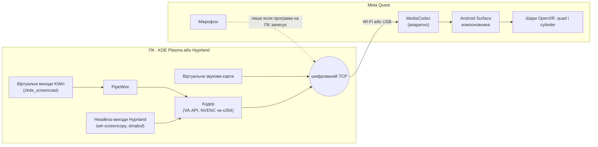

<p align="center">
  
</p>

<h1 align="center">Prostir</h1>

<p align="center">
  Додаткові монітори для KDE Plasma і Hyprland навколо вас у Meta Quest 3.
</p>

<p align="center">
  <a href="https://github.com/OlexiyOdarchuk/prostir/actions/workflows/ci-pc.yml"></a>
  <a href="https://github.com/OlexiyOdarchuk/prostir/actions/workflows/ci-headset.yml"></a>
  <a href="https://github.com/OlexiyOdarchuk/prostir/releases"></a>
  <a href="LICENSE"></a>
  
  
</p>

<p align="center">
  <a href="README.md">English</a> ·
  <a href="#що-він-уміє">Що він уміє</a> ·
  <a href="#встановлення">Встановлення</a> ·
  <a href="#користування">Користування</a> ·
  <a href="#якщо-щось-не-так-і-часті-питання">Питання</a> ·
  <a href="#безпека">Безпека</a>
</p>

---

Prostir додає ноутбуку чи ПК із KDE Plasma або Hyprland додаткові монітори, які ви
бачите в шоломі Quest. Це справжні виходи компоновника, а не картинки вікон: у KDE
вони є в «Параметри системи → Дисплей», у Hyprland у `hyprctl monitors`. На них можна
переносити й розгортати вікна, тримати там панель чи робочі столи, а миша переходить
з екрана на екран саме там, де вони стикаються перед вами.

Я написав його, бо хотів три великі монітори для ноутбука, не тягаючи їх із собою.
Користуюся щодня: KDE Plasma 6.8 і Hyprland 0.57, графіка Intel Arc, Quest 3. Це версія 0.1,
тож шорсткості трапляються. Якщо натрапите, відкрийте issue.

<p align="center">
  
</p>
<p align="center"><sub>Знімок із шолома: на правому моніторі параметри дисплея KDE з трьома виходами Prostir.</sub></p>

<p align="center">
  
</p>
<p align="center"><sub>Те саме в Hyprland: кожен монітор Prostir має свій Waybar і робочі столи.</sub></p>

<table>
  <tr>
    <td></td>
    <td></td>
  </tr>
  <tr>
    <td></td>
    <td></td>
  </tr>
</table>

<p align="center"><sub>Меню в шоломі (відрендерене на ПК через <code>--example panel_preview</code>).</sub></p>

## Що він уміє

Монітори додаються й прибираються прямо з шолома: 1080p, 1440p, 4K, широкий чи
портретний, до шести штук. Робочий стіл розставляє свої дисплеї так, як ви їх бачите,
ряд за рядом: монітори ряду поруч на одній лінії, ряд над головним зверху там, де ви
його бачите, ряд під ним знизу. Тож миша виходить з одного екрана там, де починається
наступний, і вбік, і вгору чи вниз, уздовж цілих країв, а не в кутах. У KDE на
головному моніторі панель Plasma.

Текст чіткий, бо відео потрапляє просто в шари компоновника Quest
(`XR_KHR_android_surface_swapchain`), а не в пласке вікно всередині застосунку. ПК
кодує відеоблоком відеокарти, Quest декодує апаратно. Щодня я перевіряю на графіці
Intel (VA-API); AMD через VA-API і Mesa має працювати, але не перевірялася, а NVIDIA
через NVENC працює експериментально й теж не перевірялася. Без кодера відеокарти
Prostir кодує процесором через x264, і це працює будь-де. На моєму обладнанні
закодований кадр доходить по Wi-Fi до дисплея шолома приблизно за 14 мс (мережа,
декодування й показ). Це не вся затримка від екрана до ока: захоплення й кодування
екрана додають перед цим ще кілька мілісекунд.

Для початку є три розкладки: навколо вас, на стіні або над головою, щоб дивитися
лежачи; монітори пласкі чи вигнуті. Навколо вас монітори не налазять один на одного,
скільки б їх не було: коли ряд заходив би за спину (понад 210 градусів), коло трохи
ширшає, а понад 1,5 м над головним рядом з'являється другий, потім третій. Далі беріть
будь-який монітор і ставте, куди хочете: розкладка застосовується лише тоді, коли ви
її вибираєте (або під час найпершого запуску). Новий монітор стає на вільне місце
в кінці ряду, поруч з іншими: найдовшого ряду, де є місце, з того боку, куди ви
дивитеся; над або під рядами лише тоді, коли в жодному ряду місця немає. Більше ніщо
не рухається; прибраний лишає решту на місцях. Відпустіть монітор майже
впритул до іншого, приблизно на тій самій відстані, і він прилипне край до краю; поки
тягнете, край, до якого він прилипне, світиться («Монітори» → «Прилипання»). Кнопка A
(«Вирівняти») прибирає кривизну вашої власної розстановки, не перебудовуючи її:
повернутий чи перекошений монітор, проміжки й невеликі сходинки між сусідами. Кожен
ряд лишається там, де стоїть, і так, як стоїть (скажімо, відхилений назад цілком, щоб
дивитися напівлежачи); ряди не зливаються, а проміжок, який ви лишили між рядами,
лишається. Коли в «Монітори»
→ «Тягнути» вибрано «Усі разом», будь-який узятий монітор рухає, повертає, наближає й
масштабує всю розстановку як одне ціле.

Екран самого ноутбука теж частина розстановки, тож шолом знімати не треба. Спершу він
висить під головним монітором без шва; куди ви його поставите, туди його поставить і
ПК, і миша переходить там, де ви бачите стик. Прилипання поводиться з ним як з
будь-яким монітором ряду; «Вирівняти» лишає його на місці або опускає рівно настільки,
щоб його не накрив вирівняний над ним монітор. Коли кришку закрито, він зникає.

Профілі перемикають усе налаштування одним натиском. «Робота» це те, що ви склали самі:
коли ви вперше обираєте профіль, поточні монітори зберігаються як «Робота», тож до них
завжди можна повернутися. «Кіно» (один 4K-екран, великий і далеко, решта прихована) і
«Лежачи» (два монітори над головою) готові одразу. Будь-який можна перезаписати своїм («Монітори» →
«Зберегти як профіль»). Монітори того
самого розміру при перемиканні лишаються, тож вікна на них не стрибають.

У режимі кінотеатру можна вибрати, який монітор стане великим екраном.

Режим фокусу притемнює всі монітори, крім того, де зараз миша.

Звук із ПК грає в шоломі, а мікрофон шолома стає мікрофоном ПК. Записує шолом лише тоді,
коли якась програма на ПК справді слухає, і лише поки ввімкнено перемикач мікрофона в
меню шолома («Швидке» або «Налаштування» → «Звук»). ПК може попросити мікрофон, але
вирішує перемикач у шоломі.

З «Налаштування» → «Звук» → «Звук з боку екрана» (типово вимкнено) звук лунає з боку
того монітора, де вікно, яке його грає, і лишається там, коли ви повертаєте голову. ПК
знаходить програму, що грає, через PipeWire, а її вікно через Hyprland чи KWin.
Зміщується весь звук разом, а не кожна програма окремо.

Коли ви знімаєте шолом, ПК одразу перестає кодувати. Через 5 секунд (а коли шолом
засинає, приблизно за секунду) він прибирає віртуальні монітори, і вікна, панель, звук
та мікрофон повертаються на ноутбук. Вдягнете шолом знову, і все повернеться.

Фон: чорний, ваша кімната через камери passthrough, одна з чотирьох вбудованих панорам
або своє фото. Руки можна показувати (зручно над клавіатурою), а за бажанням ними й
керувати: щипок натискає, щипок з утриманням перетягує. Коли руки в полі зору, меню
відкривається на відстані витягнутої руки й працює як сенсорний екран. Вікно на
клавіатуру показує справжній стіл крізь прямокутник, який ви кладете на клавіатуру,
на будь-якому фоні.

Окреме вікно теж можна винести з робочого столу: «Відкріпити вікно» дає активному вікну
ПК власний вихід його розміру, а шолом показує його плаваючою панеллю без рамки, ближче
до вас, ніж монітори. Таких може бути до трьох, бо відеодекодерів у шолома не так
багато. «Прикріпити» під панеллю (з'являється, коли на неї
наведено) повертає вікно на монітор, звідки його відкріпили, і виводить його з
повного екрана; закриєте вікно, і панель теж зникне. «Вікно сюди» переносить активне вікно на
монітор перед вами, а знімок екрана цього монітора потрапляє в теку Prostir у вашій
теці зображень (зазвичай `~/Pictures/Prostir`).

Монітори можуть іти слідом за головою: коли ви відвернетеся чи відійдете й явно
дивитиметеся деінде, вони плавно попливуть слідом. У Hyprland миша може йти за
поглядом і перестрибувати на монітор, на який ви дивитеся. В обох середовищах кнопка
«Де миша?» показує кільцями, де вказівник.

Коли руки показано, потримайте розкриту ліву долоню до обличчя чверть секунди, і на ній
з'явиться кругле меню: «Перед собою», «Фокус», «Кінотеатр», «Де миша?», «Знімок» і
«Вирівняти» довкола «Меню» посередині, де видно ще час, дату й заряд шолома. Натискайте сектор вказівним пальцем другої руки
або наведіть на нього промінь. Руку, що тримає меню, поверх нього не видно, а рука, яка
тягнеться до меню, стає напівпрозорою й не закриває кнопок. «Перед собою» повертає всю
розстановку так, щоб головний монітор був прямо перед вами.

Сповіщення ПК можуть з'являтися в шоломі, а нагадування можуть кликати дати очам
відпочити кожні 20 хвилин чи зробити перерву щогодини. Обидва вимкнені, доки ви самі
їх не ввімкнете.

Шолом і ПК говорять українською або англійською. Шолом бере мову ПК, якщо в меню не
вибрано іншої.

Підключення по Wi-Fi (шолом сам знаходить ПК) або, в режимі розробника, кабелем USB.
Усе шифрується, і ПК нічого не транслює шолому, з яким не сполучений.

<p align="center">
  
</p>

## Вимоги

**ПК**

- KDE Plasma 6 на Wayland або Hyprland (перевірено на 0.57, працюють і конфіги Lua, і
  `hyprland.conf`). KWin транслює віртуальні виходи сам; у Hyprland Prostir створює
  headless-виходи й захоплює їх через `wlr-screencopy` просто в буфери відеокарти.
- PipeWire з його сервером PulseAudio (`pipewire-pulse`), `pw-cli`, `pw-loopback`,
  `pactl` і `pacat`.
- GStreamer 1.24 або новіший із плагіном `va` (апаратне кодування), `h264parse` і
  `h265parse` та плагінами PipeWire і PulseAudio.
- Для апаратного кодування відеокарта з VA-API-кодером HEVC або H.264 і її драйвер
  VA: Intel перевірено, AMD має працювати, але не перевірялася. NVIDIA кодує через NVENC
  (плагін GStreamer `nvcodec`), експериментально й без перевірки. Без кодера
  відеокарти Prostir кодує на процесорі через x264, для цього потрібен плагін
  `x264enc` з gst-plugins-ugly. Див. [NVIDIA і кодування на процесорі](#nvidia-і-кодування-на-процесорі).
- У KDE `kscreen-doctor`, він іде з Plasma. Необов'язково: `qdbus6` для однакових
  шпалер, `adb` для USB і щось одне з `kdialog`, `zenity`, `fuzzel`, `wofi` чи `rofi` для
  віконця сполучення. Знімки екрана робить `grim` у Hyprland; у KDE
  Prostir розкодовує кадр із потоку саме цього монітора (а якщо не вийде, `spectacle`
  знімає весь робочий стіл).
- У Hyprland панель із треєм (Waybar з модулем `tray`) для меню і демон сповіщень
  (mako, dunst, swaync) для повідомлень. Див. [Hyprland](#hyprland).

Пакети Prostir (див. [Встановлення](#встановлення)) підтягують усе це самі. Для архіву
спершу поставте:

| Дистрибутив | Пакети |
|---|---|
| Arch | `gstreamer gst-plugins-base gst-plugins-good gst-plugins-bad-libs gst-plugin-va gst-plugin-pipewire pipewire-audio pipewire-pulse libpulse`, а на Intel ще `intel-media-driver` (драйвер AMD іде з `mesa`). Кодування на процесорі: `gst-plugins-ugly` |
| Fedora | `gstreamer1-plugins-base gstreamer1-plugins-good gstreamer1-plugins-bad-free pipewire-gstreamer pipewire-utils pipewire-pulseaudio pulseaudio-utils` і драйвер VA з кодуванням H.264/HEVC (див. нижче). Кодування на процесорі: `gstreamer1-plugins-ugly` з RPM Fusion |
| Debian 13, Ubuntu 25.04 чи новіші | `gstreamer1.0-plugins-base gstreamer1.0-plugins-good gstreamer1.0-plugins-bad gstreamer1.0-pipewire pipewire-bin pipewire-pulse pulseaudio-utils` і `mesa-va-drivers` (AMD) або `intel-media-va-driver-non-free` (Intel). Кодування на процесорі: `gstreamer1.0-plugins-ugly` |

Debian 12 і Ubuntu 24.04 мають Plasma 5, яку Prostir не підтримує.

**Fedora й openSUSE.** Їхня Mesa зібрана без кодування H.264 і HEVC, тож графіка AMD
одразу апаратного кодера не має. У Fedora ввімкніть
[RPM Fusion](https://rpmfusion.org/Configuration) і виконайте
`sudo dnf swap mesa-va-drivers mesa-va-drivers-freeworld`. На Intel `intel-media-driver`
з RPM Fusion nonfree уміє більше кодерів, ніж `libva-intel-media-driver` із Fedora. В
openSUSE кодери має збірка Mesa з Packman (`Mesa-libva`). Коли кодування працює,
`vainfo` показує `VAEntrypointEncSlice` для H.264 або HEVC. Без нього Prostir
переходить на процесор.

**Шолом**

- Meta Quest 3 або 3S, для яких Prostir і зроблено. Quest 2 і Pro не перевірялися.
- Режим розробника, щоб поставити застосунок через `adb`. Вмикається в застосунку Meta
  Horizon на телефоні: Пристрої → Налаштування шолома → Режим розробника.

### NVIDIA і кодування на процесорі

Prostir спершу пробує VA-API, потім NVENC через плагін GStreamer `nvcodec` (він у
gst-plugins-bad), якому потрібен власний драйвер NVIDIA. Шлях через NVENC
експериментальний і на справжній графіці NVIDIA ще не перевірявся; якщо спробуєте,
напишіть, як вийшло. Коли жоден кодер відеокарти не працює (немає `gst-plugin-va`,
драйвера VA чи `nvcodec`, Mesa у Fedora чи openSUSE без кодеків), Prostir сам
переходить на кодування процесором через x264. Для цього потрібен `x264enc`
(gst-plugins-ugly); це працює на будь-якому ПК, але коштує процесорного часу та трохи
затримки, тож допомагає менше чи менших моніторів. Якщо не працює нічого, шолом пише,
чого бракує, а не пробує знову й знову. `--software` вмикає кодування процесором,
навіть коли кодер відеокарти є.

## Встановлення

### Через менеджер пакетів

Пакети ставлять `/usr/bin/prostir` і підтягують залежності, перелічені вище. Зі
сховища Prostir далі оновлюється разом із рештою системи.

**openSUSE** Tumbleweed, Slowroll і Leap 16.0, **Fedora** 44 і 45, **Debian 13**,
**Ubuntu** 26.04 і 26.10: додайте сховище, зібране на
[openSUSE Build Service](https://build.opensuse.org/package/show/home:iShawyha:prostir/prostir).

```sh
# openSUSE Tumbleweed. Slowroll: openSUSE_Slowroll, Leap: 16.0
sudo zypper addrepo --refresh https://download.opensuse.org/repositories/home:iShawyha:prostir/openSUSE_Tumbleweed/home:iShawyha:prostir.repo
sudo zypper refresh          # відповідь "a", щоб довіряти ключу сховища
sudo zypper install prostir
```

```sh
# Fedora 45. Fedora 44: Fedora_44
sudo dnf config-manager addrepo --from-repofile=https://download.opensuse.org/repositories/home:iShawyha:prostir/Fedora_45/home:iShawyha:prostir.repo
sudo dnf install prostir     # спитає підтвердити ключ сховища
```

```sh
# Debian 13. Ubuntu: xUbuntu_26.04 або xUbuntu_26.10
repo=https://download.opensuse.org/repositories/home:/iShawyha:/prostir/Debian_13
sudo mkdir -p /etc/apt/keyrings
curl -fsSL "$repo/Release.key" | sudo tee /etc/apt/keyrings/prostir.asc > /dev/null
echo "deb [signed-by=/etc/apt/keyrings/prostir.asc] $repo/ /" | sudo tee /etc/apt/sources.list.d/prostir.list
sudo apt update && sudo apt install prostir
```

**Arch** (AUR): `yay -S prostir-bin`.

Кожен [реліз](../../releases) має ще `.deb` і `.rpm` (x86_64), щоб поставити вручну,
без оновлень: `sudo apt install ./prostir_<версія>-1_amd64.deb` або
`sudo dnf install ./prostir-<версія>-1.x86_64.rpm` у Fedora.

**ARM (aarch64), експериментально.** Сховища збирають Prostir і для 64-бітного ARM,
наприклад для Fedora Asahi Remix на Apple Silicon чи ноутбука зі Snapdragon X. У
Tumbleweed для ARM пишіть в адресі вище `openSUSE_Factory_ARM`. Ці збірки не
перевірені. ПК без кодувальника HEVC чи H.264 у VA-API (Asahi, Raspberry Pi 5) кодує
процесором через x264, а це навантажує процесор і потребує `x264enc` (див.
[NVIDIA і кодування на процесорі](#nvidia-і-кодування-на-процесорі)).

### Через Nix

Репозиторій є flake з частиною для ПК:

```sh
nix run github:OlexiyOdarchuk/prostir          # спробувати
nix profile install github:OlexiyOdarchuk/prostir
```

У NixOS додайте `github:OlexiyOdarchuk/prostir` як вхід flake і покладіть
`inputs.prostir.packages.${pkgs.system}.default` у `environment.systemPackages`.
GStreamer з плагінами йде разом. Кодування відеокартою бере системний драйвер VA-API
у NixOS (`hardware.graphics.enable`), а в інших дистрибутивах вбудовані драйвери Intel
і Mesa (AMD); NVIDIA потребує системного драйвера, тож поза NixOS кодує процесор.
`nix develop` відкриває оболонку для роботи над частиною для ПК.

### З архіву релізу

1. Завантажте `prostir-<версія>-x86_64-linux.tar.gz`, `prostir-<версія>.apk` і
   `SHA256SUMS` з [релізів](../../releases) і перевірте їх:
   `sha256sum -c --ignore-missing SHA256SUMS`.
2. На ПК:
   ```sh
   tar xf prostir-*-x86_64-linux.tar.gz && cd prostir-*/
   ./install.sh             # у ~/.local, без root
   ./install.sh --autostart # те саме, і Prostir запускається після входу (KDE)
   ```
   Скрипт попереджає, якщо `~/.local/bin` немає в `PATH`, а в Hyprland друкує рядки,
   які треба додати в конфіг.

### На шолом

Увімкніть режим розробника й підключіть шолом кабелем USB:

```sh
adb install prostir-*.apk
```

### Брандмауер

ПК слухає TCP-порт 47830 і оголошує себе UDP-розсилкою на порт 47831. Якщо на ПК
працює брандмауер, дозвольте обидва:

```sh
sudo ufw allow 47830/tcp && sudo ufw allow 47831/udp            # ufw (Ubuntu)
sudo firewall-cmd --add-port=47830/tcp --add-port=47831/udp --permanent \
  && sudo firewall-cmd --reload                                 # firewalld (Fedora, openSUSE)
```

### Hyprland

- **Трей і повідомлення.** Меню Prostir живе в треї, тож потрібна панель із треєм,
  наприклад Waybar з модулем `tray`. Для повідомлень (сполучення, оновлення) потрібен
  демон сповіщень: mako, dunst чи swaync.
- **Автозапуск.** Hyprland без uwsm не читає теку автозапуску XDG, тож додайте Prostir у
  конфіг. Для встановлення з архіву пишіть повний шлях, бо `~/.local/bin` часто немає в
  `PATH` Hyprland:
  ```lua
  -- hyprland.lua
  hl.on("hyprland.start", function () hl.exec_cmd("~/.local/bin/prostir serve") end)
  ```
  ```ini
  # hyprland.conf
  exec-once = ~/.local/bin/prostir serve   # або просто "prostir serve", якщо ставили пакет
  ```
- **Дозволи.** Якщо ввімкнено `ecosystem:enforce_permissions`, дозвольте Prostir
  захоплювати екран:
  `hl.permission("/usr/(local/)?bin/prostir|.*/\\.local/bin/prostir", "screencopy", "allow")`
  у `hyprland.lua` або `permission = /usr/(local/)?bin/prostir|.*/\.local/bin/prostir, screencopy, allow`
  у `hyprland.conf`.
- **Віконце сполучення.** Prostir питає код через `kdialog` чи `zenity` або через
  `fuzzel`, `wofi` чи `rofi` в режимі dmenu. Поставте щось одне з них.

### Із сирців

```sh
# ПК
cargo build --release -p prostir
./scripts/install.sh

# Quest: потрібні Android SDK з NDK і build-tools та ціль Rust
rustup target add aarch64-linux-android
./scripts/build-apk.sh --install   # збирає build/prostir.apk і ставить через adb
# Застосунок перевіряє себе в шоломі проти фальшивого ПК (кожна збірка, крім збірки для магазину):
# числа рядками ключ=значення, код виходу 0, коли все пройшло (збірка preview, якщо
# вона стоїть; більше в --help)
./scripts/selftest-headset.sh
```

## Користування

1. Запустіть Prostir на ПК з меню застосунків або командою `prostir`. У треї з'явиться
   іконка. Уперше вікно налаштувань спитає, чи рахувати цей ПК серед користувачів
   Prostir (див. [Безпека](#безпека)); без відповіді «Так» нічого не надсилається.
2. У шоломі відкрийте Prostir: Бібліотека → Невідомі джерела.
3. Шолом шукає ПК спершу на кабелі USB (лише в режимі розробника), потім у Wi-Fi.
   Якщо знайде рівно один ПК, підключиться до нього сам. Якщо кілька, оберіть свій
   або введіть IP ПК на клавіатурі.
4. Уперше шолом покаже «Новий ПК» з іменем і адресою ПК. Натисніть «Сполучити» (або
   «Не зараз», якщо це не ваш ПК), і шолом покаже 6-значний код; введіть його в
   маленькому віконці, що відкриється на ПК. Якщо зручніше навпаки, кнопка під кодом
   показує код на ПК (у треї та сповіщенні), а ви вводите його в шоломі.
5. Перед вами з'явиться монітор 2560×1440. Додайте ще на вкладці меню «Монітори» й
   натисніть A, щоб вирівняти їх.

Якщо з'єднання обірвалося, монітори 30 секунд чекають (`--linger`), чи шолом
повернеться, і лише потім вікна переїжджають на ноутбук.

### Wi-Fi чи USB

Wi-Fi працює для всіх: ПК і шолом мають бути в одній мережі, і мережа має пускати
пристрої один до одного. Інший спосіб: кабель USB. Він рятує в мережах, що
відгороджують пристрої один від одного (готелі, офіси, деякі mesh-роутери), звільняє
Wi-Fi і дає найстабільнішу картинку. Для нього потрібні режим розробника на шоломі й
`adb` на ПК. Встановлення з Meta Horizon Store, коли Prostir там з'явиться,
працюватимуть лише через Wi-Fi.

### Підключення кабелем USB

1. Увімкніть на шоломі режим розробника: у застосунку Meta Horizon на телефоні
   відкрийте Пристрої → ваш шолом → Налаштування шолома → Режим розробника.
2. Встановіть `adb` на ПК: `sudo pacman -S android-tools` (Arch),
   `sudo apt install adb` (Debian, Ubuntu) або `sudo dnf install android-tools`
   (Fedora).
3. З'єднайте шолом із ПК кабелем USB-C, який передає дані (а не лише заряджає). Найкраще
   порт USB 3; USB 2 вистачає на три монітори за звичайної якості.
4. Вдягніть шолом. Він спитає «Allow USB debugging?»: позначте «Always allow from this
   computer» і дозвольте.
5. Перевірте, що `adb devices` показує шолом як `device`. Якщо там `unauthorized`,
   від'єднайте кабель, під'єднайте знову й дайте відповідь у шоломі.
6. Запустіть Prostir на ПК (або лишіть запущеним). Раз на кілька секунд він шукає
   шоломи на USB і для кожного виконує `adb reverse tcp:47830 tcp:47830`, тож шолом
   дістається до ПК за адресою 127.0.0.1.
7. Відкрийте Prostir у шоломі. Він пробує кабель раніше за Wi-Fi, і в меню буде
   «Підключено до ПК (USB)». Сполучення таке саме, як по Wi-Fi, один раз для кожного ПК.

Від'єднаєте кабель, і шолом сам повернеться на Wi-Fi. `prostir --no-adb` забороняє ПК
чіпати `adb`. Порт ноутбука зазвичай заряджає шолом повільніше, ніж той розряджається
під час роботи, тож для довгих сеансів заряджайте його заздалегідь або беріть хаб із
живленням.

### Керування

| | Контролер | Руки (меню → Налаштування → Керування → Руки → І керувати) |
|---|---|---|
| Відкрити меню | ☰ або X на лівому контролері, або кругла кнопка ☰ під головним монітором | системний жест меню (щипок лівою рукою долонею до себе) або «Меню» посередині меню на долоні |
| Меню на долоні | | потримати розкриту ліву долоню до обличчя; натискати вказівним пальцем правої руки або наводити промінь |
| Натиснути кнопку в меню | курок | торкнутися пальцем або щипок здалеку |
| Клік на моніторі | курок | щипок |
| Перенести монітор | тримати grip і вказувати | щипок з утриманням приблизно 0,3 с будь-де на ньому |
| Перенести всі монітори разом | «Монітори» → «Тягнути» → «Усі разом», тоді переносити будь-який монітор | так само |
| Повернути відкріплене вікно | навести на нього й натиснути «Прикріпити» під ним | так само, щипком |
| Перенести меню | тримати grip і наводити | щипок з утриманням приблизно 0,3 с будь-де на ньому (і на кнопці), або торкнутися пальцем порожнього місця й тягнути |
| Ближче чи далі | стік вгору чи вниз, поки тримаєте | відсунути чи наблизити руку (зблизька воно йде за рукою) |
| Більше чи менше | стік вліво чи вправо, поки тримаєте, або взяти обома контролерами й розвести чи звести | взяти обома руками й розвести чи звести |
| Вирівняти монітори | A або меню → Монітори → «Вирівняти» | «Вирівняти» в меню на долоні або меню → Монітори → «Вирівняти» |
| Головний монітор прямо перед собою | меню → Швидке → Перед собою | так само або «Перед собою» в меню на долоні |

Коли руки в полі зору, меню відкривається на відстані витягнутої руки, щоб його можна
було торкатися. Світла пляма показує, куди зараз торкнеться палець; щоб натиснути
наступну кнопку, відведіть палець. Шульга? «Налаштування» → «Керування» → «Меню на
долоні» → «На правій руці» переносить меню на праву руку, а натискати його лівою.

### Меню

**Швидке** відкривається першим: три профілі («Робота», «Кіно», «Лежачи») і великі
плитки для того, що перемикаєте щодня: «Перед собою», «Фокус», «Кінотеатр», «Вікно на
клавіатуру», «Звук ПК», «Мікрофон», «Відкріпити вікно», «Вікно сюди» і «Знімок
екрана». Увімкнене підсвічено.

**Монітори** починаються з карти моніторів так, як їх видно з вашого місця; екран
ноутбука блідіший. Натисніть монітор, щоб вибрати його: під картою його номер, розмір і
де він стоїть (ліворуч, по центру, праворуч, згори, знизу), «Зробити головним» і ×,
щоб прибрати. Тут же список відкріплених вікон із кнопкою, щоб закрити. Далі екран
ноутбука (показано чи приховано), «Вирівняти: прибрати шви (кнопка A)» і «Зберегти як
профіль». Поруч: додати монітор (1920×1080, 2560×1440, 3840×2160, 3440×1440 або
1440×2560), розкладка («Навколо мене», «Стіна», «Лежачи»), вигин, «Слідом за
головою», «Прилипання», «Тягнути» («Один монітор» чи «Усі разом») і екран для
кінотеатру. Сам кінотеатр вмикається плиткою у «Швидкому» і сектором меню на долоні.

«Вирівняти» зберігає вашу розстановку й вирівнює її ряд за рядом: на «Стіні» в площині
стіни, у «Лежачи» над головою так, як вона стоїть; у кінотеатрі екран будується
заново. Профіль пам'ятає, де стояли його монітори, тож перехід на нього й назад
повертає ваші ряди. Прилипання
працює й на «Стіні», у її площині, але не в «Лежачи», не в кінотеатрі й не тоді, коли
тягнете всі монітори разом.

**Налаштування** мають кілька розділів:

- **Вигляд**: фон (чорний, кімната, притемнена кімната, панорама або своє фото), режим
  фокусу, вікно на клавіатуру, нагадування про відпочинок, яскравість моніторів. Для свого фону скопіюйте
  еквідистантну панораму `background.jpg` або `background.png` у
  `/sdcard/Android/data/dev.prostir.client/files/` на шоломі.
- **Керування**: руки, миша за поглядом (де ПК це дозволяє), розмір меню, на якій руці
  меню на долоні («Меню на долоні»: ліва чи права рука), і частота екрана шолома (90 Hz
  або 72 Hz, щоб заощадити заряд: відео в будь-якому разі йде 60 кадрів на секунду), і
  чи показувати круглу кнопку меню біля монітора.
- **Звук**: де грає звук ПК, який мікрофон використовує ПК, і звук з боку екрана.
- **Мова**: як на ПК, українська або англійська; годинник меню на долоні у 24 чи 12
  годин (14:05 або 2:05 PM) і дата мовою меню, українською, англійською чи числами.
- **ПК**: якість відео (15, 30 або 50 Мбіт/с на монітор), кодування відеокартою чи
  процесором, HEVC чи H.264, чіткіший текст, сповіщення ПК у шоломі і ПК, з якими
  сполучено шолом; будь-який із них можна забути. Якість і чіткіший текст ПК застосовує
  одразу; інший кодек перезапускає кодери за секунду, а монітори й вікна лишаються. ПК
  запам'ятовує цей вибір.
- **Довідка**: керування, версія і знову підказки першого запуску.

### Трей на ПК

Трей показує, чи підключено шолом, скільки моніторів і заряд шолома; коли той падає до
15 %, ПК показує сповіщення. З трею можна поставити монітори перед собою, змінити якість
відео й чіткіший текст (ті самі налаштування, що в меню шолома), запуск разом із
системою (KDE), відкрити налаштування, увімкнути чи вимкнути лічильник користувачів,
забути сполучені шоломи й вийти.

### Командний рядок

```
prostir
prostir serve [--monitor WxH[@scale]]... [--codec hevc|h264] [--bitrate MBPS] [--software]
              [--keep-primary] [--linger SECONDS] [--port PORT] [--no-discovery] [--no-adb]
prostir ctl КОМАНДА [--json]
prostir mcp
```

`prostir`, який запускає значок у меню, відкриває вікно налаштувань, а якщо Prostir не
працює, спершу запускає його у фоні. `prostir serve` запускає Prostir у фоні (так його
запускають автозапуск, systemd і `exec-once` у Hyprland). Вікно працює окремим
процесом, тож фонова частина ніколи не завантажує його графічних бібліотек (EGL, X11).
`-v` чи `--version` з будь-якою командою показує версію.

`prostir ctl` звертається до Prostir, що працює, з термінала, скрипту чи гарячої
клавіші (комбінації клавіш KDE, `bind` у Hyprland): `prostir ctl recenter`, `prostir
ctl profile 1`, `prostir ctl closer 2`, `prostir ctl monitor add 2560x1440@125%`,
`prostir ctl quality 50`, `prostir ctl status`, `prostir ctl watch` (рядок на кожну
зміну, до Ctrl+C). `prostir ctl help` показує всі команди. З `--json` кожна пише JSON.
Код виходу каже, що вийшло: 0 зроблено, 1 не вдалося, 2 Prostir не працює чи немає
шолома, 3 немає відповіді вчасно, 64 неправильні аргументи.

Інші програми дістають те саме на сеансовій шині D-Bus як
`io.github.OlexiyOdarchuk.Prostir` (лише програми вашого ж користувача). Команда шолому
може тривати до 30 с, довше, ніж `busctl` і `gdbus` чекають за замовчуванням, тож
дайте їм `--timeout=35`:

```
busctl --user --timeout=35 call io.github.OlexiyOdarchuk.Prostir \
    /io/github/OlexiyOdarchuk/Prostir io.github.OlexiyOdarchuk.Prostir1 Recenter
```

Методи, сигнали, помилки й JSON стану описано в [LOCAL-API.md](LOCAL-API.md).

`prostir mcp` дає те саме агентові ШІ через Model Context Protocol: він може додавати
монітори, розставляти їх, чекати, поки вони запрацюють, і дивитися знімок монітора.
Для Claude Code: `claude mcp add prostir -- prostir mcp`. Інструменти описано в
[LOCAL-API.md](LOCAL-API.md#mcp-prostir-mcp).

Без `--monitor` Prostir повертає монітори з минулого сеансу, кожен зі своїм номером,
тож шолом знаходить його там, де він був. Вони записані в
`~/.config/prostir/screens.txt` разом із рядами, у яких їх показує шолом, а
налаштування (якість, чіткіший текст, кодек, звук, мікрофон, екран ноутбука, лічильник)
у `~/.config/prostir/settings.txt`; обидва файли звичайний текст. Перший запуск 0.2.0
переносить їх із `monitors.txt` версії 0.1, який лишається як був. Параметри
командного рядка (`--monitor`, `--bitrate`, `--codec`, `--software`) діють лише на цей
запуск і не записуються; записується те, що ви змінюєте під час роботи, а набір
моніторів, змінений у шоломі, заміняє набір із `--monitor`.

## Оновлення й видалення

**Оновлення.** Зі сховища чи AUR Prostir оновлюється разом із системою
(`sudo zypper dup` у Tumbleweed і Slowroll, `sudo zypper up` у Leap, `sudo dnf upgrade`,
`sudo apt upgrade`, `yay -Syu`). Інакше ставте нову версію так само, як стару
(`sudo apt install ./prostir_<версія>-1_amd64.deb`,
`sudo dnf upgrade ./prostir-<версія>-1.x86_64.rpm`) або запустіть `./install.sh` з
нового архіву.
На шоломі `adb install -r prostir-<версія>.apk` зберігає налаштування й сполучення.
Налаштування й сполучені шоломи на ПК лишаються в `~/.config/prostir`.

Оновлюйте обидва боки, коли можете. Невелика різниця версій з'єднання не ламає; коли
версії надто далекі, шолом каже, який бік оновити.

**Видалення.**

- Встановлення з архіву: `./install.sh --uninstall` прибирає програму, пункт меню,
  іконку й автозапуск. `./install.sh --uninstall --purge` прибирає ще й налаштування
  та сполучені шоломи в `~/.config/prostir`.
- Пакети: `sudo pacman -R prostir-bin`, `sudo zypper remove prostir`,
  `sudo apt remove prostir` або `sudo dnf remove prostir`. Пакети не чіпають домашньої
  теки; за бажання приберіть `~/.config/prostir` і `~/.config/autostart/prostir.desktop`
  самі. Щоб прибрати й сховище: `sudo zypper removerepo home_iShawyha_prostir`,
  `sudo rm /etc/yum.repos.d/home:iShawyha:prostir.repo` у Fedora або
  `sudo rm /etc/apt/sources.list.d/prostir.list /etc/apt/keyrings/prostir.asc`.
- Hyprland: приберіть рядки, які ви додали в конфіг.
- Шолом: `adb uninstall dev.prostir.client` або видаліть застосунок у Бібліотеці. Це
  стирає і його налаштування та ключі сполучення.

## Обмеження

- KDE Plasma 6 і Hyprland на Wayland. GNOME поки не підтримується: якщо він вам
  потрібен, поставте 👍 в [issue #1](https://github.com/OlexiyOdarchuk/prostir/issues/1). Сеанси X11 не підтримуються.
- У Hyprland немає головного монітора, тож «Зробити головним» там лише вибирає, який
  монітор шолом ставить перед вами.
- Апаратне кодування перевірено лише на графіці Intel (VA-API). AMD через VA-API і
  Mesa має працювати, але не перевірялася; NVIDIA через NVENC працює експериментально
  й не перевірялася. Де не працює ні те, ні те, Prostir кодує процесором, а це коштує
  процесорного часу й трохи затримки.
- Зроблено для Quest 3 і 3S, перевірено на Quest 3. Quest 2 і Pro не перевірялися.
- Застосунку поки немає в Meta Horizon Store: його ставлять у режимі розробника через
  `adb`, і Quest показує його в «Невідомих джерелах» під назвою пакета `dev.prostir.client`.
- Один шолом на ПК водночас.

## Продуктивність і батарея

Заміри на моєму ноутбуці (графіка Intel) з трьома моніторами 2560×1440 і екраном
ноутбука в шоломі:

- ПК використовує близько 2 % одного ядра. Пам'ять залежить від кодека, бо драйвер
  Intel резервує чимало під кожен кодер HEVC: близько 340 МБ з HEVC, близько 120 МБ з
  H.264 («Налаштування» → «ПК» → «Кодек»). Поки Prostir чекає на шолом, він займає
  близько 16 МБ, а після сеансу віддає пам'ять. Кодування процесором (x264) бере
  набагато більше процесорного часу.
- У мережі кожен монітор бере до вибраного бітрейту, поки картинка змінюється, і майже
  нічого, коли вона стоїть. Звук додає 1,5 Мбіт/с.
- У шоломі сам застосунок під час трансляції бере близько 40 % одного ядра
  (розшифровування йде на криптографічних інструкціях ARMv8). Кожен монітор займає один
  апаратний декодер (простоює на нерухомій картинці) і один шар компоновника щокадру.
  Найбільше заощаджують менша кількість чи розмір моніторів, чорний фон, сховані руки й
  частота екрана 72 Hz. Фони «Кімната» й «Притемнена» тримають камери passthrough
увімкненими.

## Безпека

Кожне з'єднання починається з рукостискання Noise `XX` (Curve25519, AES-256-GCM,
BLAKE2s). Після нього картинка, звук і мікрофон шифруються й автентифікуються.

Шолом і ПК сполучаються один раз. Доти ПК надсилає лише те, що потрібно для
сполучення (повідомлення сполучення, текст помилки або свою версію, коли версії не
можуть працювати разом), не створює моніторів і не надсилає ні картинки, ні звуку.
Шолом не сполучається з ПК сам: спершу питає. 6-значний код проходить через SPAKE2,
тож той, хто записав трафік, не підбере його офлайн, а підтвердження прив'язане до
рукостискання саме цього з'єднання, і це зупиняє «людину посередині». Після невдалих
спроб ПК чекає дедалі довше, перш ніж прийняти наступну, тож код не вгадати перебором.

ПК зберігає ключі сполучених шоломів у `~/.config/prostir/paired_headsets`; пункт трею
«Забути сполучені шоломи» очищає цей список. Шолом зберігає свої ключі всередині
застосунку, а сполучені ПК показує в «Налаштування» → «ПК», де будь-який можна забути.

Шолом надсилає звук мікрофона лише тоді, коли ввімкнено його власний перемикач
мікрофона (меню, «Швидке» або «Налаштування» → «Звук»). ПК може попросити мікрофон, але
ввімкнути перемикач не може.

Коли ввімкнено «Сповіщення ПК у шоломі», ПК читає сповіщення, які інші програми
надсилають сесійною шиною, і передає шолому назву програми, заголовок і текст тим самим
шифрованим з'єднанням. Він перестає їх читати, щойно ви це вимкнете або шолом
від'єднається.

Prostir може рахувати, на скількох ПК він працює, лише якщо ви погодитеся. Коли вікно
налаштувань відкривається вперше, воно питає «Рахувати цей ПК серед користувачів
Prostir?» з кнопками «Так» і «Ні», жодна не вибрана заздалегідь. Без відповіді «Так»
нічого не надсилається, тож ПК, де ніхто не відповів (лише `prostir serve`, сервер),
не рахується ніколи. Якщо так, раз на день, коли підключається шолом, ПК надсилає один
запит на GoatCounter лише з датою (а вперше ще `/install`). Жодного ідентифікатора,
імені ПК чи налаштувань у ньому немає. Змінити відповідь можна будь-коли на сторінці
«Огляд» вікна налаштувань, у треї («Рахувати цей ПК серед користувачів») або командою
`prostir ctl count yes|no`; змінна `PROSTIR_NO_COUNT=1` вимикає підрахунок за
будь-якої відповіді. Після оновлення з 0.1, де підрахунок працював, доки його не
вимкнуть, вікно теж питає один раз; якщо його було вимкнено, він лишається вимкненим і
питання не буде.
Кожна збірка спершу питає, тож рахувати може кожна релізна збірка, зокрема зібрана з
вихідного коду. Налагоджувальні збірки не рахують ніколи. Дистрибутив, якому
підрахунок не потрібен, збирає без можливості `count` (`cargo build
--no-default-features --features desktop`), і тоді вікно не питає. Ключ для
підрахунку лежить у вихідному коді (`crates/prostir/count.key`), а отже, в кожній
збірці; прочитати його може будь-хто, але він уміє лише додавати відліки, тож
найгірше, що з ним можна зробити, це накрутити числа. Див. [політику
конфіденційності](https://prostir.ishawyha.dev/uk/privacy.html).

Маяк пошуку містить лише ім'я ПК. Порти перелічено в розділі
[Брандмауер](#брандмауер).

Про проблему з безпекою можна повідомити приватно через
[приватні звіти про вразливості на GitHub](https://github.com/OlexiyOdarchuk/prostir/security/advisories/new).

## Якщо щось не так і часті питання

**Логи.** Шолом: `adb logcat -s prostir`. ПК: запустіть `prostir` у терміналі;
`RUST_LOG=debug prostir` додає конвеєр GStreamer і час кодування.

**Шолом бачить мій ПК, але підключення нічого не дає.** Брандмауер на ПК блокує
TCP-порт 47830. Дозвольте його, див. [Брандмауер](#брандмауер).

**Шолом не знаходить ПК.** Обидва мають бути в одній мережі, і мережа не повинна
ізолювати клієнтів (гостьові часто ізолюють). Брандмауер теж може блокувати
UDP-розсилку на порт 47831. Введіть IP ПК на клавіатурі або підключіть кабель (режим
розробника).

**Немає картинки, або шолом каже, що бракує кодера.** Перевірте, що є в GStreamer:
`gst-inspect-1.0 vah265enc vah264enc x264enc`. Поставте плагін і драйвер VA для свого
дистрибутива (в Arch це `gst-plugin-va`) або `gst-plugins-ugly` для кодування
процесором. Для Fedora й openSUSE з графікою AMD див. примітку про кодеки у
[Вимогах](#вимоги).

**У мене карта NVIDIA.** Prostir пробує NVENC через плагін GStreamer `nvcodec`; це
експериментально й не перевірялося. Якщо не вийде, він сам кодує процесором через
x264, тож поставте й gst-plugins-ugly. Див. [NVIDIA і кодування на процесорі](#nvidia-і-кодування-на-процесорі).

**На ПК не відкривається віконце сполучення.** Поставте `zenity` чи `kdialog` або
майте `fuzzel`, `wofi` чи `rofi`. Або натисніть кнопку під кодом у шоломі, щоб зробити
навпаки: ПК покаже код у треї та сповіщенні, а ви введете його в шоломі.

**Hyprland: немає іконки в треї, сповіщень чи автозапуску.** Див. [Hyprland](#hyprland).

**`prostir: command not found` після `install.sh`.** `~/.local/bin` немає у вашому
`PATH`. Запускайте `~/.local/bin/prostir` або додайте теку в `PATH` у профілі оболонки.

**Звук ПК лишається на ноутбуці, або програми не бачать мікрофона шолома.** Prostir
перемикає типовий вихід і вхід через `pactl`. Поставте його (`libpulse` в Arch,
`pulseaudio-utils` у Debian, Ubuntu й Fedora) або виберіть «Prostir» у налаштуваннях
звуку вручну.

**Шолом каже оновити ПК чи шолом.** Версії надто далекі одна від одної. Поставте
найновіший реліз на той бік, який він назвав.

**`adb install` падає з `INSTALL_FAILED_UPDATE_INCOMPATIBLE`.** Встановлений застосунок
підписано іншим ключем (наприклад, ви збирали його самі). Спершу видаліть його:
`adb uninstall dev.prostir.client`; це стирає налаштування й сполучення шолома.

**14 мс це вся затримка?** Ні. Це час від закодованого кадру до дисплея шолома по
Wi-Fi. Захоплення й кодування екрана йдуть перед цим і додають кілька мілісекунд.

**Знімок на Quest вийшов чорним.** Деякі режими знімка не беруть шари компоновника,
якими малює Prostir. Змініть формат знімка в налаштуваннях камери Quest.

## Як це працює



Протокол описано в [PROTOCOL.md](PROTOCOL.md).

Код поділено на крейти Rust, усі в `crates/`:

```
crates/prostir-proto/    протокол і шифрування, спільні для ПК і шолома
crates/prostir-layout/   де стоять монітори: правила розкладки, спільні для ПК і шолома
crates/prostir-api/      типи локального API, спільні для програми на ПК і її клієнтів
crates/prostir-lang/     переклади як дані (Fluent)
crates/prostir/          програма для ПК: віртуальні виходи, кодери, звук, трей, пошук
crates/prostir-window/   вікно налаштувань на ПК (бібліотека prostir: prostir window)
crates/prostir-client/   застосунок для Quest: цикл OpenXR (app.rs), меню (ui.rs), розкладки (layout.rs), …
crates/prostir-testkit/  фальшивий шолом і фальшивий ПК для тестів і для перевірки програм вручну
scripts/  build-apk.sh, install.sh, package-release.sh, third-party-licenses.py,
          selftest-headset.sh, selftest-clips.sh
docs/     сайт (prostir.ishawyha.dev) і картинки для цього README
```

У Hyprland ті самі завдання йдуть через його IPC-сокет: `output create headless`,
правила моніторів (Lua `eval` або `keyword`) для розкладки й монітор у фокусі для
режиму фокусу. Кадри захоплюються в буфери відеокарти з тайлінгом, який конвертер
VA-API читає напряму, тож через процесор нічого не проходить.

Крім трансляції, ПК розставляє виходи в KDE через `kscreen-doctor`, копіює шпалери на
всі монітори через скриптовий API Plasma, транслює екран ноутбука через `stream_output`
і питає KWin, на якому виході миша, для режиму фокусу. Для звуку з боку екрана він раз
на півтори секунди дивиться, яка програма грає (потоки PipeWire несуть id її процесу),
і де її вікно (список клієнтів Hyprland або скрипт KWin). Застосунок для Quest написано
на Rust поверх OpenXR; монітори малює компоновник, а сам застосунок рендерить лише руки.

`cargo test` запускає тести протоколу, розкладок, профілів і меню на ПК. `cargo e2e`
запускає програму для ПК з несправжньою стільницею проти несправжнього шолома
(сполучення, монітори, зняття шолома, перепідключення, зміна кодека); потрібен
GStreamer з x264enc. Водночас іде стільки тестів, скільки половина процесорів, але не
менше чотирьох; `PROSTIR_E2E_JOBS=N` задає інше число.
`cargo run -p prostir-client --example panel_preview -- menu.png` рендерить меню шолома
в PNG (`TAB=monitors|look|controls|sound|language|pc|help`, `LANG_UI=en`, `WRIST=1`), а `--example sky_preview -- DIR`
рендерить панорами. `cargo run -p prostir-testkit --bin prostir-probe -- [HOST:PORT]
[SECONDS] [DIR]` підключається як шолом, сполучається і зберігає отримані відео й звук,
щоб перевірити ПК без шолома.

## Схожі проєкти

- [qwayland](https://github.com/jboero/qwayland): та сама ідея з 2D-панелями Horizon OS
  і кодуванням на NVIDIA.
- `krfb-virtualmonitor` (частина Krfb від KDE): додає в KWin віртуальний монітор і
  віддає його через VNC, тож його покаже в пласкому вікні будь-який VNC-клієнт на Quest.
- [WiVRn](https://github.com/WiVRn/WiVRn) або [ALVR](https://github.com/alvr-org/ALVR)
  разом із [WayVR](https://github.com/galister/wlx-overlay-s) (колишній wlx-overlay-s):
  транслюють із ПК цілий сеанс OpenXR чи SteamVR, а наявні екрани й програми показують
  у ньому як оверлеї. Правильний вибір для VR-ігор.
- [Breezy Desktop](https://github.com/wheaney/breezy-desktop): віртуальні монітори в KDE
  Plasma 6 і GNOME для XR-окулярів на кшталт XREAL і VITURE, не для Quest. Відкритий
  код; функції для роботи після безкоштовного пробного періоду потребують ліцензії.
- [Immersed](https://immersed.com): пропрієтарний, на кількох платформах. У Linux його
  вбудовані віртуальні монітори працюють у GNOME на Wayland.
- [Virtual Desktop](https://www.vrdesktop.net): пропрієтарний; його програма для ПК
  працює у Windows і macOS, не в Linux.

Навіщо ще один? Prostir робить одну річ у Linux: нові монітори, які є справжніми
виходами KWin чи Hyprland, тож вікна, панелі й миша поводяться з ними як із
підключеними екранами. На ПК не потрібне VR-середовище (ні SteamVR, ні Monado),
компоновник Quest малює монітори напряму, а звук ПК і мікрофон шолома працюють разом
із ними. Водночас він уміє менше за проєкти вище: жодних VR-ігор, жодних Windows,
macOS чи GNOME, і один шолом на ПК.

## Ліцензія

[GPL-3.0-or-later](LICENSE) з [додатковим дозволом](LICENSE-EXCEPTION.md) лінкуватися з
Meta Platform SDK (потрібен лише для збірки в Horizon Store). Вбудований шрифт Noto Sans
поширюється під
[SIL Open Font License 1.1](crates/prostir-client/assets/OFL-NotoSans.txt). Кожен реліз містить
`THIRD-PARTY-LICENSES.txt` з ліцензіями крейтів Rust, шрифту й завантажувача Khronos
OpenXR, що є у файлах релізу. Архів і пакети ставлять його поряд із текстом GPL, а APK
містить його в `assets/licenses/`. Пише його `scripts/third-party-licenses.py`.

Meta і Meta Quest є торговими марками Meta Platforms, Inc. KDE і Plasma є торговими
марками KDE e.V. Prostir є незалежним проєктом, не пов'язаним із ними й не схваленим
ними.
